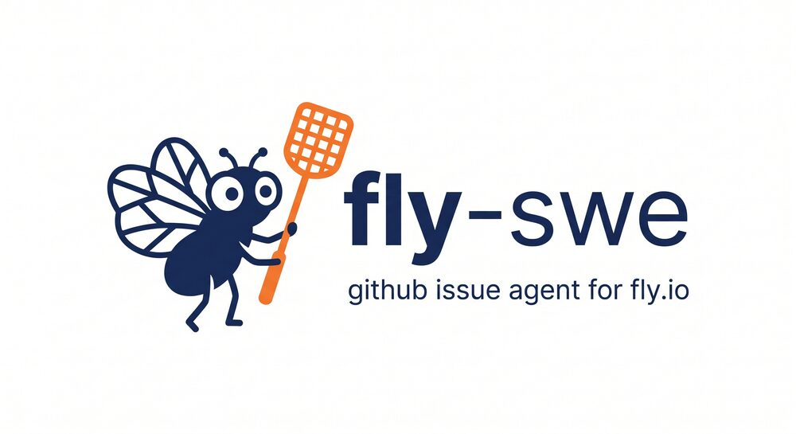
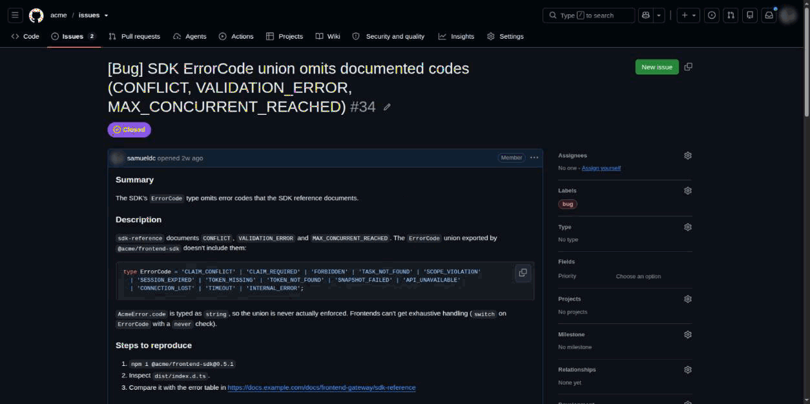
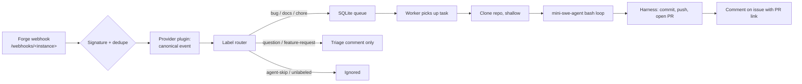

<p align="center">
  
</p>

<h1 align="center">A lightweight agent that resolves your GitHub issues</h1>

<p align="center">
  Built on <a href="https://github.com/SWE-agent/mini-swe-agent">mini-swe-agent</a>.
  Robust, model-agnostic, and deployable in about ten minutes.
</p>

<p align="center">
  <a href="https://github.com/stateway-io/fly-swe/actions/workflows/ci.yml"></a>
  
  
  
  
</p>

<p align="center">
  <a href="#quickstart--deploy-in-10-minutes">Quickstart</a> ·
  <a href="./docs/operations.md">Operations</a> ·
  <a href="./docs/label-schema.md">Label schema</a> ·
  <a href="./docs/providers.md">Providers</a> ·
  <a href="#contributing">Contributing</a>
</p>

---

Label an issue `bug`, `docs`, or `chore`. fly-swe clones the repo, drives
[mini-swe-agent](https://github.com/SWE-agent/mini-swe-agent) through it,
runs your test suite, and opens a Pull Request that closes the issue —
truthfully: if the tests didn't pass, the PR says so.

<p align="center">
  
  <br>
  <sub>A real run, end to end: $0.27 and 85 iterations from label to PR. Repository names and private code are anonymized.</sub>
</p>

It's a standing service, not a one-shot CLI invocation: a FastAPI webhook
receiver and a worker, sharing a durable SQLite queue, running as one
process pair on one small machine. Point it at a repo, and it keeps
triaging issues for as long as it's deployed.

GitHub is the built-in forge. The core never talks to it directly: every
forge sits behind a [provider plugin](#provider-plugins), so others (GitLab,
Gitea, Gogs, …) can be added without touching the agent.

## How it works



The agent's job ends when it emits a completion signal; everything from
that point — `git add`, the commit, the push, the PR — belongs to the
harness, never to the LLM. This is a hard invariant enforced in code (see
[docs/operations.md § The Agent Execution Contract](./docs/operations.md#the-agent-execution-contract)):
the coding agent edits files and leaves them in the working tree, and
nothing else. It's also why a target repo's own `AGENTS.md`/`CLAUDE.md` that
tells contributors to "commit and open a PR" doesn't cause chaos — the
system prompt tells the agent to follow those files for style and tests,
never for git.

[](https://gitdiagram.com/stateway-io/fly-swe/video)

## Why fly-swe

- **A service, not a session.** Webhooks land in a durable SQLite queue with
  delivery idempotency, backoff retries, and orphan recovery on restart — a
  crashed Machine picks up exactly where it left off, nothing lost, nothing
  double-run.
- **Bash only.** No bespoke tool schema, no function-calling gymnastics —
  inherited from mini-swe-agent's linear, hackable loop. The whole
  transcript is a sequence of shell commands and their output; if the agent
  did something surprising, you can read exactly why.
- **Model-agnostic, for real.** Any [LiteLLM](https://docs.litellm.ai)-routable
  model that supports tool calling: Anthropic, OpenRouter, DeepSeek, a
  self-hosted gateway via `api_base` — the LLM provider is read from the
  model string or an explicit config field, never guessed from your API key's
  shape. `llm.fallback` gives you automatic failover to a second model.
- **Budget-governed by construction, not by convention.** Per-task cost cap,
  per-repo daily cap, iteration cap, wall-clock cap, per-command timeout —
  and `cost_tracking: strict` refuses to run a step it can't price rather
  than spending blind.
- **Resumable.** A run stopped by a timeout or budget limit doesn't just
  die — it force-pushes its partial work to a WIP branch, and the next
  trigger continues from exactly there, informed by a summary of what the
  previous attempt already tried. That handoff summary costs zero LLM
  tokens by default.
- **Honest about testing.** The harness independently re-runs whatever test
  command the agent says it used, in the same sandboxed environment, after
  the agent's loop has already ended. The PR's "How I tested" section
  reflects what the harness actually observed. The checks the agent itself
  ran or could not run (say, a suite that needs a database the sandbox
  lacks) are listed under it, clearly labeled as the agent's report and
  never checked off as verified.
- **Small operational footprint.** One shared-CPU Fly Machine, one 1&nbsp;GB
  volume, one SQLite file. No Postgres, no Redis, no message broker to run
  or pay for.
- **Cross-repo dispatch.** Issues can live in one repo while PRs land in
  another — useful when issue triage and code live in different places.
  `Closes` references are automatically qualified as `owner/repo#N` so
  GitHub's auto-close still works.

## What it costs

Two line items: the Fly Machine, and the LLM tokens each issue consumes.

- **Infrastructure:** the default `fly.toml` runs one always-on `shared-cpu-1x`
  Machine with 1&nbsp;GB of RAM, plus a 1&nbsp;GB volume. That comes to roughly
  US$6/month at Fly's [published pricing](https://fly.io/pricing/) when
  this was written.
- **LLM, measured on a real repository:** 10 consecutive issues (bugs and docs)
  on a TypeScript monorepo, mostly with GLM-5.3 (`z-ai/glm-5.3`). Every one
  ended in a human-reviewed PR.

  | | Cost per issue | Iterations |
  |---|---|---|
  | Median | ~US$0.31 | ~80 |
  | Cheapest | US$0.02 | 13 |
  | Most expensive | US$1.85 | 225 (two automatic retries after a failed verification) |

  The total for all 10 was about US$4.50. Cost depends heavily on the model, on
  the repository and on the issue. The [budget caps](#configuration-at-a-glance)
  bound the worst case regardless.

## Quickstart — deploy in ~10 minutes

This is the fast path; every step links to the full procedure in
[docs/operations.md](./docs/operations.md).

1. **Create a GitHub App**
   ([guide](./docs/operations.md#obtaining-and-configuring-the-github-app-private-key))
   with `Contents`, `Pull requests`, and `Issues` set to Read & Write, and
   subscribed to the `Issues` and `Issue comment` events. Point its webhook
   at `https://<your-app>.fly.dev/webhooks/github` — the path ends in the
   provider instance id (`providers.github` below). Download its private
   key.

2. **Install the App** on the repo(s) you want triaged (and the target repo,
   if different — see
   [cross-repo dispatch](./docs/operations.md#onboarding-an-issue-repository)).

3. **Create the routing labels**
   ([full list + `gh label create` commands](./docs/label-schema.md)) —
   `bug`, `docs`, `chore`, `question`, `feature-request`, and two override
   labels, `agent-fix-please` / `agent-skip`.

4. **Configure the agent:**

   ```bash
   git clone https://github.com/stateway-io/fly-swe.git && cd fly-swe
   cp config.yaml.example config.yaml
   cp .env.example .env
   # Edit config.yaml: providers.github.app_id (and bot_login),
   #                  repos: your (issues, target) pair, llm.model
   # Edit .env: PROVIDERS__GITHUB__APP_PRIVATE_KEY_PATH,
   #            PROVIDERS__GITHUB__WEBHOOK_SECRET, LLM_API_KEY
   ```

5. **Deploy:**

   ```bash
   export FLY_APP=<your-app-name>   # fly.toml deliberately carries no app name
   flyctl apps create "$FLY_APP"    # first time only
   flyctl secrets set \
     CONFIG_YAML="$(base64 -w0 < config.yaml)" \
     PROVIDERS__GITHUB__APP_PRIVATE_KEY="$(cat path/to/private-key.pem)" \
     PROVIDERS__GITHUB__WEBHOOK_SECRET=<value> \
     LLM_API_KEY=<value>
   flyctl deploy --remote-only
   ```

6. **Verify:**

   ```bash
   curl https://<your-app>.fly.dev/readyz   # {"status": "ready", ...}
   ```

   Open an issue labeled `bug` on your repo and watch `flyctl logs`. Full
   verification checklist in
   [docs/operations.md § Onboarding an Issue Repository](./docs/operations.md#onboarding-an-issue-repository).

Want to run it locally first? `uv sync && uv run honcho start` boots the web
server and worker together; use [smee.io](https://smee.io) to forward GitHub
webhooks to `localhost`. Details in
[CONTRIBUTING.md](./CONTRIBUTING.md#getting-set-up).

## Configuration at a glance

Everything non-secret lives in one commented YAML file. Precedence is
**env var > `config.yaml` > code default**, and in production the file
ships as a base64 Fly secret — changing it restarts the Machine, no
redeploy needed.

```yaml
agent:
  name: issue-agent          # shown in comments and PRs

providers:
  github:                    # instance id → webhook URL /webhooks/github
    type: github             # built-in provider type
    app_id: 123456           # GitHub App ID (not a secret)
    bot_login: my-app[bot]   # the App's bot account
    # host: https://ghe.example.com   # GitHub Enterprise

repos:
  - issues: owner/repo       # where issues come from
    target: owner/repo       # where PRs are opened (omit = same repo)
    # provider: github       # required only with several instances
    base_branch: main
    workflow: trunk_based    # trunk_based | gitflow

llm:
  model: anthropic/claude-sonnet-4-5   # any LiteLLM <provider>/<model> id
  cost_tracking: strict                # refuse to run unmetered
  fallback:
    model: ""                          # optional failover model

budgets:
  max_iterations: 50
  max_cost_per_task_usd: 2.00
  max_daily_cost_usd: 50.00
  task_timeout_seconds: 900
```

| Block | Covers |
|---|---|
| `agent` | The agent's display name in comments and PRs |
| `providers` | Forge instances by id: `type` plus that type's fields (GitHub: App ID, bot login, Enterprise host) |
| `repos` | Issue/target repo pairs, their provider instance, branch strategy, per-repo test/lint commands and LLM override |
| `llm` | Model, LLM provider, fallback, cost tracking mode, prompt caching |
| `budgets` | Iteration/cost/time caps, per-command timeout |
| `worker` | Poll interval, orphan timeout, retry backoff schedule |
| `pr` | Branch slug length, the label applied to agent PRs |
| `comments` | Progress comments, who can trigger the agent via comment, conversation context size |
| `resume` | Whether a blocked run preserves and resumes partial work |
| `git` | Workspace clone depth (full history by default, so the agent can date an existing fix) |
| `git_identity` | Commit author name/email for harness commits |
| `metrics` | Prometheus port and histogram buckets |
| `prompts` | Label category → prompt template mapping |
| `policy` | Which label categories route to `TRIAGE_ONLY` / `DIAGNOSE` (defaults reproduce the built-in routing) |
| `toolchains` | On-demand runtimes for target repos (e.g. Node.js): install root, default versions, timeouts |
| `retention` | How long trajectories, DB rows, and audit logs are kept |

Secrets never go in `config.yaml` — the loader refuses them there. They come
from env / `fly secrets`: `LLM_API_KEY`, and per provider instance
`PROVIDERS__<ID>__<FIELD>` (`<ID>` is the instance id in upper case, e.g.
`PROVIDERS__GITHUB__WEBHOOK_SECRET`). Any non-secret field can be overridden
the same way.

The full annotated reference is [config.yaml.example](./config.yaml.example)
— every field is documented inline. Upgrading from a 0.x config with
top-level `github:` / `github_app:` sections? See
[docs/operations.md § Upgrading to 1.0.0](./docs/operations.md#upgrading-to-100--provider-instances).

## Label routing

| Label | Default action | Notes |
|---|---|---|
| `bug` | **FIX** | Unless promoted to triage by `severity:high`/`severity:critical` |
| `docs` | **FIX** | Documentation / README / API reference edits |
| `chore` | **FIX** | Light refactor, lint, dependency bump |
| `question` | TRIAGE_ONLY | Acknowledges and defers to a human |
| `feature-request` | TRIAGE_ONLY | Records it; a human decides whether to build it |
| `agent-fix-please` | **FIX** (override) | Forces a fix attempt on an otherwise-unlabeled issue |
| `agent-skip` | SKIP (override) | Always wins, regardless of other labels |
| *(none of the above)* | SKIP | |

There's also a fourth action, **DIAGNOSE**: the agent inspects the repo
read-only and posts a verdict on whether a label matches reality — it never
edits files or opens a PR. It's opt-in per category via `config.yaml`'s
`policy.diagnose_categories` (empty by default).

Which categories route to TRIAGE_ONLY/DIAGNOSE is configurable
(`policy:` in `config.yaml.example`); the table above shows the defaults.
Full contract, suggested colours, and issue-form template wiring in
[docs/label-schema.md](./docs/label-schema.md).

## Provider plugins

The agent, the queue, the label router and the runner are forge-neutral.
Everything that knows a forge's webhook format, API, auth or URL syntax
lives in a **provider plugin** under `src/issue_agent/providers/<type>/`,
behind a few small ports ([`providers/base.py`](./src/issue_agent/providers/base.py)):

| Port | Job |
|---|---|
| `WebhookAdapter` | Verify the signature (fail closed), give the delivery's idempotency key, normalize the payload into a canonical `TriggerEvent` |
| `ForgeClient` | Issue operations on one repo: state, comments, labels, default branch |
| `PullRequestClient` | Optional — find/open/comment on PRs; a forge without a PR API omits it and the harness publishes the branch with a compare link instead |
| `GitTransport` | Tokenless clone URL, per-process git credentials, PR/compare URLs, `#N`-style references |
| `capabilities` | What the forge supports (drafts, labels, auto-close) and its vocabulary (`issue`, `Pull Request` / `Merge Request`), which the prompts render with |

A **type** is code (`github` is the only built-in one today); an
**instance** is config. Each entry under `providers.<id>` gets its own
webhook URL (`/webhooks/<id>`), its own secrets (`PROVIDERS__<ID>__*`) and
its own `/readyz` checks, so github.com and a GitHub Enterprise host can run
side by side. The provider is picked from the URL path, never sniffed from
headers.

Want to add GitLab, Gitea/Forgejo, Gogs or your own forge? The guide is
[docs/providers.md](./docs/providers.md); every plugin is held to the same
conformance test suite. The design record is the [PRD](./PRD.md).

## Deploying elsewhere

fly-swe was built for [Fly.io](https://fly.io): cheap always-on Machines,
Firecracker VM isolation per Machine, and volumes that make a single SQLite
file a legitimate production database. `fly.toml`'s `[[files]]` block
mounting `config.yaml` from a secret, and `flyctl deploy --remote-only`
building the image for you, are what make the ten-minute quickstart above
possible.

The service itself is unopinionated about hosting. All it needs is:

- a Docker image (the provided `Dockerfile` builds one, non-root, `slim`
  base),
- **one persistent volume** mounted at `/data` (SQLite database, workspaces,
  event trajectories, audit logs),
- an **always-on** process — the worker polls a queue, so scale-to-zero
  platforms (Cloud Run, Vercel, Lambda) don't fit without a persistent-disk
  workaround.

That maps cleanly onto **Render**, **Railway**, **Koyeb**, **AWS App Runner**
or **ECS with EFS**, or a plain **Hetzner/DigitalOcean** box running
`docker compose` with a bind-mounted volume. Anywhere that gives you a
container, a disk, and an always-running process works.

## Status, limitations & roadmap

**Execution is not sandboxed today.** The agent's shell commands run via
`subprocess` inside the same container as the web server and worker — not
in Docker-in-Docker, not in a per-task VM. Mitigated by an environment
variable allowlist (no secret ever reaches the agent's shell), a tokenless
git remote, no push credential and no `gh` CLI, and explicit prompt-level
constraints against reading credentials or touching CI config. Full threat
model in [SECURITY.md](./SECURITY.md).

**Roadmap: a sandboxed execution environment**, most likely built on
[SWE-ReX](https://github.com/SWE-agent/SWE-ReX) — mini-swe-agent's own
remote-execution layer — to run each task in an isolated, disposable
environment instead of the shared container.

**One task at a time, on one Machine.** Deliberate — it's what makes the
small-footprint, low-cost story hold. Fan-out across repos is still fair:
the queue round-robins so one busy repo can't starve the others.

## Built on

- **[mini-swe-agent](https://github.com/SWE-agent/mini-swe-agent)** —
  the ~100-line agent loop that drives the coding session. fly-swe adds the
  webhook service, the durable queue, budget governance, and the resume
  machinery around it; the loop itself is upstream's.
- **[LiteLLM](https://docs.litellm.ai)** for model routing, **FastAPI** for
  the webhook receiver, **[Fly.io](https://fly.io)** for the reference
  deploy target.

If you use mini-swe-agent's research in your own work, see its
[citation](https://github.com/SWE-agent/mini-swe-agent#citation).

## Contributing

```bash
git clone https://github.com/stateway-io/fly-swe.git && cd fly-swe
uv sync
uv run honcho start        # runs web + worker locally
uv run pytest               # unit + integration tests
uv run ruff check && uv run ruff format --check
```

```
src/issue_agent/
├── main.py             → FastAPI entry
├── worker.py           → worker loop
├── config.py           → Pydantic Settings (env > config.yaml > default)
├── core/               → canonical model (TriggerEvent, IssueRef, Author, Comment), PR text
├── providers/          → provider ports, registry, settings union, github/ (webhook adapter, App auth, API client, PR ops, git transport)
├── webhook/            → dispatcher POST /webhooks/{instance_id}, health
├── queue/              → SQLite store, models, schema
├── policy/             → label router, guards, ingestion filters, comment-author filter
├── runner/             → workspace, agent_factory, prompts, executor, diagnose, toolchains/
├── triage/ diagnose/   → triage and diagnosis comment builders
└── observability/      → audit log, metrics, alerts, cleanup
prompts/                → system.md, system_diagnose.md + templates per label (forge-neutral)
docs/                   → operations runbook, troubleshooting, label schema, provider guide
```

Local webhook testing uses [smee.io](https://smee.io) to forward GitHub
deliveries to `localhost`. Full contributor guide, git conventions, and PR
expectations in [CONTRIBUTING.md](./CONTRIBUTING.md); instructions for
coding agents working in this repo are in [AGENTS.md](./AGENTS.md); adding a
forge is covered in [docs/providers.md](./docs/providers.md).

## Maintained by Stateway

fly-swe is built and maintained by [Stateway](https://stateway.io), a hosted
BPMN process engine, and it triages Stateway's own issues in production.

## License

Copyright (C) 2026 Samuel Diniz Casimiro.

fly-swe is free software, licensed under the
[GNU Affero General Public License v3.0](./LICENSE) (`AGPL-3.0-only`). You
can use, modify and self-host it freely; if you run a modified version as a
network service, you must offer its users the corresponding source code
(AGPL § 13).
